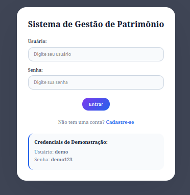
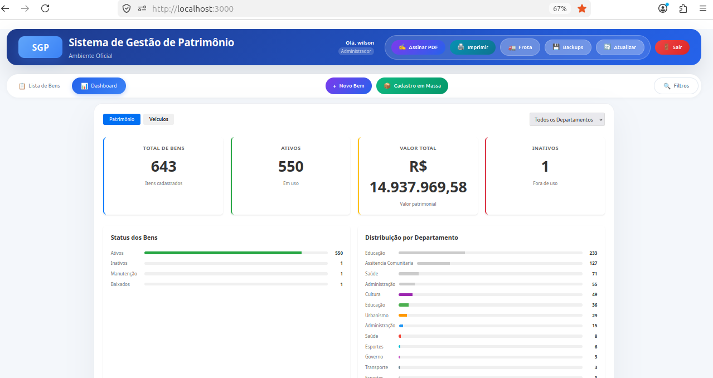
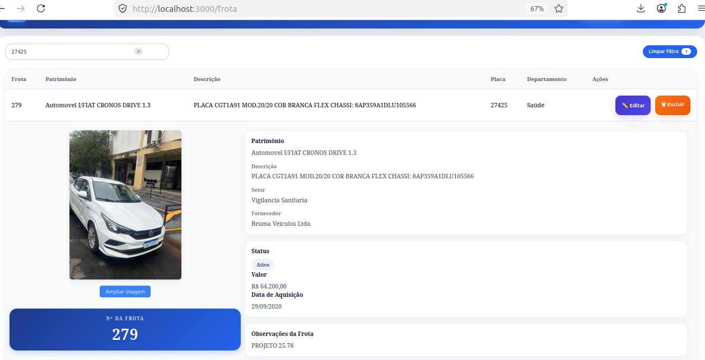
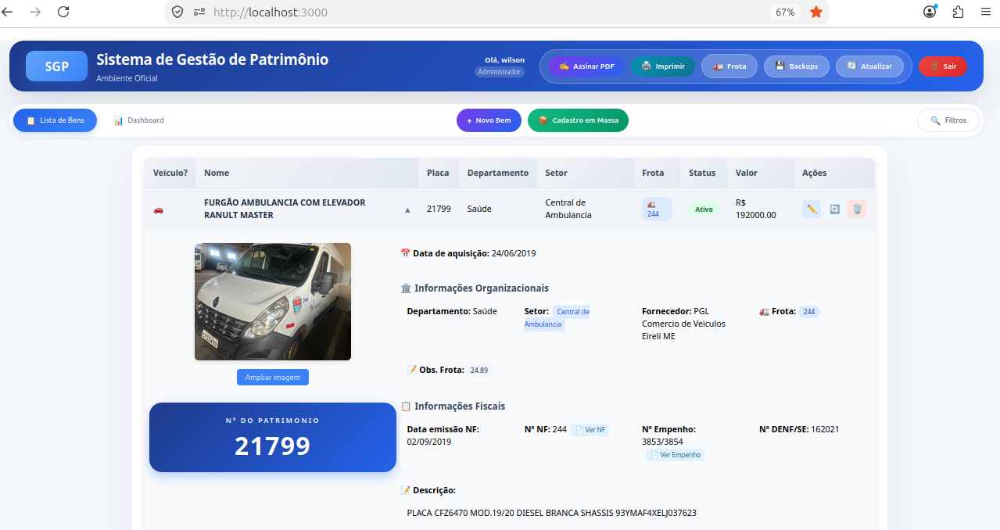
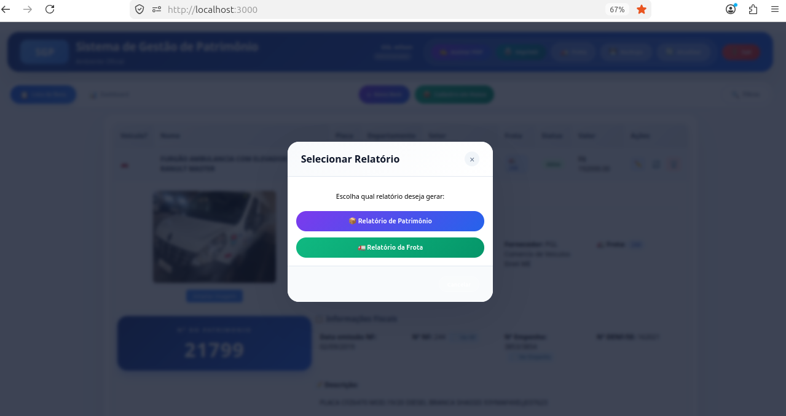
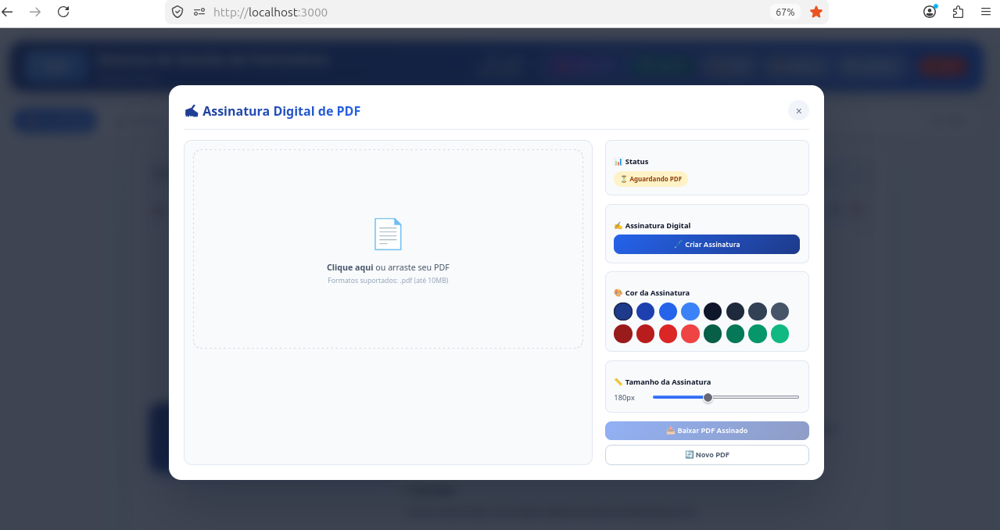
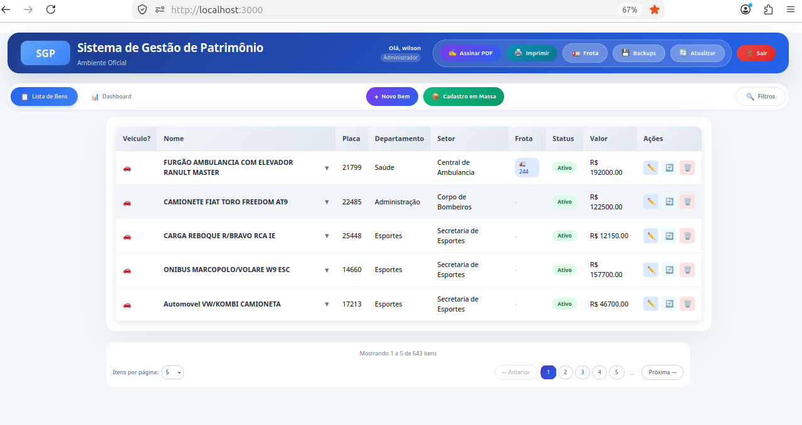

# 🏛️ Patrimony System - Sistema de Gestão de Patrimônio Público



> **Sistema completo para gestão de bens patrimoniais de prefeituras e órgãos públicos**

## 🌟 Sobre o Projeto

O **Patrimony System** é uma solução enterprise para gestão de patrimônio público, desenvolvida para atender as necessidades de prefeituras, secretarias e órgãos governamentais. O sistema oferece controle total sobre bens patrimoniais, desde o cadastro até a baixa, com recursos avançados de IA para classificação e detecção de danos.

### 🎯 Principais Funcionalidades

| Funcionalidade | Descrição |
|----------------|-----------|
| 🏷️ **Cadastro de Bens** | Registro completo com placa única, fotos e especificações |
| 📸 **Upload de Imagens** | Galeria de fotos para cada patrimônio |
| 🔄 **Controle de Movimentação** | Entrada, saída e transferência entre setores |
| 🤖 **Classificação por IA** | Categorização automática de bens |
| 🩺 **Detecção de Danos** | IA para identificar e classificar danos |
| 📊 **Relatórios** | Estatísticas e relatórios gerenciais |
| 📱 **App Mobile** | Acesso via dispositivos móveis (React Native) |

## 📸 Screenshots do Sistema

### 🔐 Tela de Login


*Interface de autenticação do sistema*

### 📊 Dashboard


*Painel de controle com indicadores e estatísticas*

### 🚗 Gestão de Frota


*Módulo de gestão de frota e veículos*

### 📄 Visualização de Patrimônio


*Detalhamento completo de bens patrimoniais*

### 🖨️ Impressão de Documentos


*Geração e impressão de documentos oficiais*

### 📑 Assinatura de PDF


*Sistema de assinatura digital de documentos*

### 📋 Página de Listagem


*Visualização e filtros da lista de patrimônios*

## 🏗️ Arquitetura do Sistema

┌─────────────────────────────────────────────────────────────────┐
│ FRONTEND (Next.js) │
│ Interface Web e Dashboard │
└─────────────────────────────┬───────────────────────────────────┘
│
┌─────────────────────────────▼───────────────────────────────────┐
│ BACKEND (Rust + Actix-web) │
│ API REST e Lógica de Negócio │
└─────────────────────────────┬───────────────────────────────────┘
│
┌─────────────────────────────▼───────────────────────────────────┐
│ AI SERVICE (Python/Flask) │
│ Classificação e Detecção de Danos │
└─────────────────────────────┬───────────────────────────────────┘
│
┌─────────────────────────────▼───────────────────────────────────┐
│ DATABASE (PostgreSQL) │
│ Dados de Patrimônio e Movimentações │
└─────────────────────────────────────────────────────────────────┘

┌─────────────────────────────────────────────────────┐
│ MOBILE (React Native / Expo) │
│ Acesso via dispositivos móveis │
└─────────────────────────────────────────────────────┘
text


## 🚀 Tecnologias Utilizadas

### Backend
- 🦀 **Rust** - Performance e segurança
- ⚡ **Actix-web** - Framework web assíncrono
- 🗄️ **SQLx** - ORM assíncrono
- 🐘 **PostgreSQL** - Banco de dados relacional

### Frontend
- ⚛️ **Next.js** - Framework React
- 📘 **TypeScript** - Tipagem estática
- 🎨 **Tailwind CSS** - Estilização moderna

### Inteligência Artificial
- 🐍 **Python** - Processamento de IA
- 🌶️ **Flask** - API de serviços de IA
- 🧠 **TensorFlow** - Modelos de ML

### Mobile
- 📱 **React Native** - Aplicativo mobile
- 🏃 **Expo** - Framework para React Native

### Infraestrutura
- 🐳 **Docker & Docker Compose** - Containerização
- 🔐 **Backup Automático** - Scripts de backup e restore

## 📂 Estrutura do Projeto

patrimony-system/
├── backend/ # Backend em Rust
│ ├── src/
│ │ ├── main.rs # Ponto de entrada
│ │ ├── database/ # Configuração do banco
│ │ ├── models/ # Modelos de dados
│ │ ├── services/ # Lógica de negócio
│ │ └── routes/ # Rotas da API
│ ├── Cargo.toml # Dependências Rust
│ └── Dockerfile # Docker para backend
├── frontend/ # Frontend Next.js
│ ├── src/
│ │ ├── pages/ # Páginas do Next.js
│ │ ├── components/ # Componentes React
│ │ └── styles/ # Estilos CSS
│ ├── public/images/ # Imagens do sistema
│ ├── Dockerfile # Docker para frontend
│ └── package.json # Dependências Node.js
├── PatrimonyMobileNew/ # App Mobile React Native
│ ├── src/ # Código fonte mobile
│ ├── App.js # Ponto de entrada mobile
│ └── package.json # Dependências mobile
├── ai-service/ # Serviço de IA em Python
│ ├── app.py # API Flask
│ └── models/ # Modelos treinados
├── documents/ # Documentação do sistema
├── backups/ # Backups do banco de dados
├── uploads/ # Uploads de imagens
├── docker-compose.yml # Orquestração Docker
├── start.sh # Script de inicialização
├── backup.sh # Script de backup
├── restore-backup.sh # Script de restore
└── README.md # Este arquivo
text


## ⚡ Como Executar

### Pré-requisitos

```bash
# Docker e Docker Compose
sudo apt-get install docker.io docker-compose

# Node.js (para desenvolvimento mobile)
curl -fsSL https://deb.nodesource.com/setup_18.x | sudo -E bash -
sudo apt-get install -y nodejs

# Rust (para desenvolvimento backend)
curl --proto '=https' --tlsv1.2 -sSf https://sh.rustup.rs | sh

Inicialização Rápida
bash

# 1. Clonar o repositório
git clone https://github.com/wil-ckaew/patrimony-system.git
cd patrimony-system

# 2. Dar permissão de execução
chmod +x start.sh backup.sh restore-backup.sh

# 3. Iniciar o sistema
./start.sh

# Ou manualmente com Docker Compose
docker-compose up -d --build

# 4. Verificar serviços
docker-compose ps

# 5. Acessar o sistema
# Frontend: http://localhost:3000
# Backend API: http://localhost:8080
# AI Service: http://localhost:5000

Comandos Disponíveis
Comando	Descrição
./start.sh	Inicia todos os serviços
docker-compose down	Para todos os serviços
./backup.sh	Faz backup do banco de dados
./restore-backup.sh	Restaura último backup
./restore.sh backups/backup-YYYY-MM-DD.sql	Restaura backup específico
📱 Executando o App Mobile
bash

# Entrar na pasta do mobile
cd PatrimonyMobileNew

# Instalar dependências
npm install

# Atualizar tipos (se necessário)
npm install @types/react@~19.1.10 --save-dev
npm install typescript@~5.9.2 --save-dev

# Iniciar o app
npx expo start --clear

Configuração do Mobile

No arquivo de configuração do app, ajuste o IP do backend:
javascript

// Configuração de conexão
const API_URL = 'http://SEU_IP:8080/api';

🔄 Backup e Restore
Fazer Backup
bash

./backup.sh
# Gera: backups/backup-YYYY-MM-DD.sql
# e backups/backup-latest.sql (link simbólico)

Restaurar Backup
bash

# Restaurar último backup
./restore-backup.sh

# Restaurar backup específico
./restore.sh backups/backup-2025-09-05.sql

Fluxo de Atualização Seguro
bash

# 1. Fazer backup antes de atualizar
./backup.sh

# 2. Parar e atualizar
docker-compose down
git pull

# 3. Reconstruir e iniciar
docker-compose up --build -d

# 4. Restaurar dados
./restore-backup.sh

🛠️ Resolução de Problemas
Erro: "Interactive prompt was cancelled" no Expo
bash

# Quando o Expo pergunta sobre login, selecione:
# "Proceed anonymously" (seta para baixo + Enter)

Erro: Porta já em uso
bash

# Verificar processos na porta
sudo lsof -i :8080
sudo kill -9 PID

# Ou reiniciar Docker
docker-compose down
docker system prune -a
./start.sh

Erro: Mobile não conecta ao backend
bash

# Verificar IP do backend
docker-compose ps
docker inspect backend | grep IPAddress

# Atualizar configuração do app com o IP correto

Erro: Banco de dados corrompido
bash

# Restaurar backup mais recente
./restore-backup.sh

# Ou recriar do zero
docker-compose down -v
./start.sh

📊 Funcionalidades Detalhadas
Cadastro de Patrimônios

    ✅ Número de placa único

    ✅ Descrição detalhada

    ✅ Categoria e tipo

    ✅ Valor e data de aquisição

    ✅ Setor/Secretaria responsável

    ✅ Estado de conservação

    ✅ Upload de imagens

Movimentações

    ✅ Entrada de novos bens

    ✅ Baixa de patrimônios

    ✅ Transferência entre setores

    ✅ Histórico completo

Relatórios

    ✅ Lista geral de patrimônios

    ✅ Relatórios por setor

    ✅ Bens por categoria

    ✅ Itens danificados

    ✅ Estatísticas de valor

Integração com IA

    ✅ Classificação automática

    ✅ Detecção de danos

    ✅ Recomendações de manutenção

🤝 Como Contribuir

    Fork o projeto

    Crie sua feature branch (git checkout -b feature/AmazingFeature)

    Commit suas mudanças (git commit -m 'Add some AmazingFeature')

    Push para a branch (git push origin feature/AmazingFeature)

    Abra um Pull Request

📞 Contato

Desenvolvedor: Wilson (wil-ckaew)

https://img.shields.io/badge/GitHub-100000?style=for-the-badge&logo=github&logoColor=white
https://img.shields.io/badge/LinkedIn-0077B5?style=for-the-badge&logo=linkedin&logoColor=white
📜 Licença

Distribuído sob licença MIT. Veja LICENSE para mais informações.
<div align="center"> <h3>🏛️ Patrimony System - Gestão de Patrimônio Público com Eficiência</h3> <p><i>"Tecnologia a serviço da gestão pública"</i></p> </div> ```
📋 Script para subir as alterações
bash

#!/bin/bash
# save as: upload-patrimony.sh

echo "🚀 Atualizando README do Patrimony System..."

cd ~/rust/patrimony-system

# Verificar status
echo "📊 Status atual:"
git status

# Adicionar README e imagens
echo ""
echo "📁 Adicionando arquivos..."
git add README.md
git add frontend/public/images/*.png

# Fazer commit
echo ""
echo "💾 Fazendo commit..."
git commit -m "docs: atualiza README com imagens e documentação completa

- Adiciona descrição detalhada do sistema
- Inclui screenshots (login, dashboard, frota, visualização)
- Adiciona estrutura completa do projeto
- Melhora documentação de instalação e uso
- Inclui instruções para mobile e IA
- Adiciona seção de backup e restore"

# Push
echo ""
echo "⬆️ Enviando para o GitHub..."
git push origin main

if [ $? -eq 0 ]; then
    echo ""
    echo "✅ Upload concluído com sucesso!"
    echo "🌐 Acesse: https://github.com/wil-ckaew/patrimony-system"
else
    echo ""
    echo "❌ Falha no push. Verifique a autenticação."
fi

Execute:
bash

chmod +x upload-patrimony.sh
./upload-patrimony.sh

📊 Resumo das imagens incluídas
Imagem	Descrição
login.png	Tela de autenticação
dashboard.png	Painel de controle
frota.png	Gestão de frota
visualizaçao.png	Visualização de bens
imprimir.png	Impressão de documentos
assinarpdf.png	Assinatura digital de PDF
page.png	Listagem de patrimônios

Pronto! Seu README do Patrimony System agora está completo, profissional e visualmente atraente! 🏛️✨